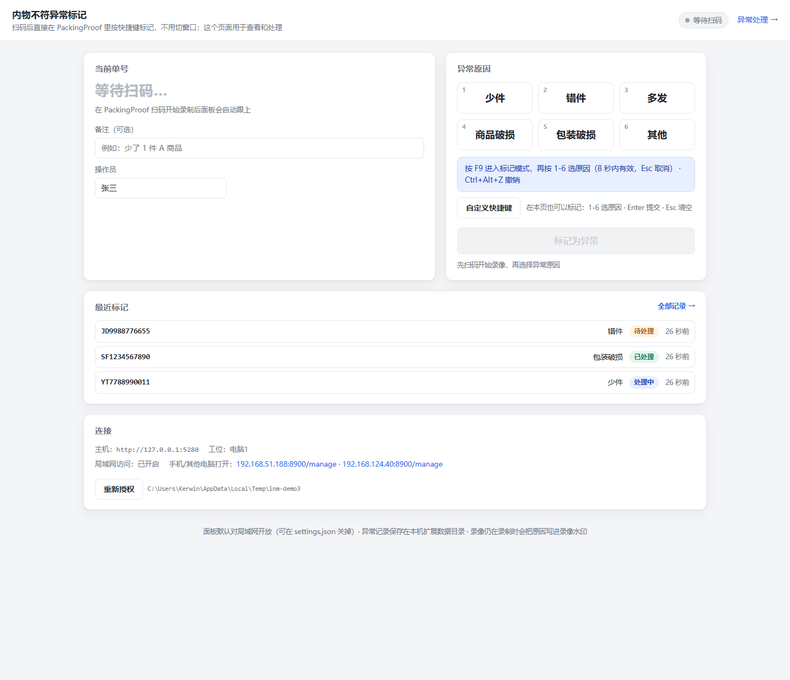
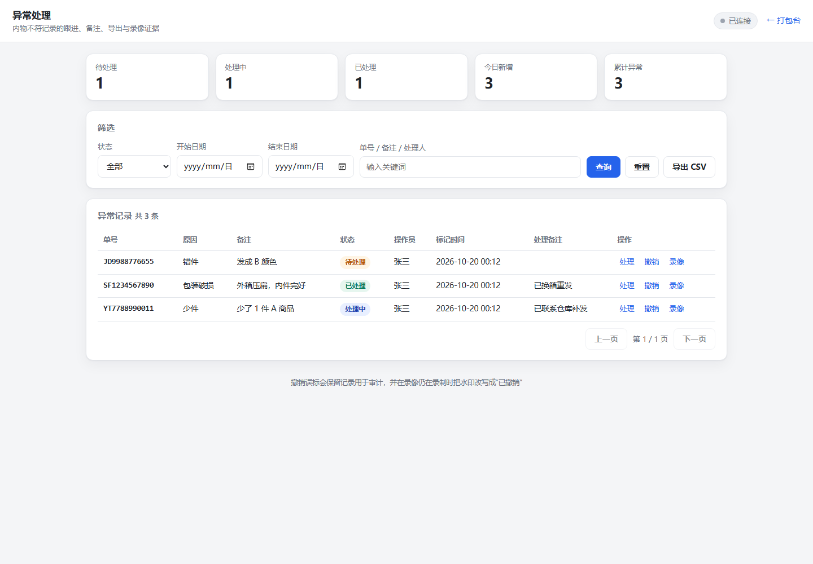

# 内物不符异常标记（PackingProof 扩展）

扫码录像是为了留证，但**「内物不符」这件事本身没有留证**：包裹拆开后发现少件、错件、多发、破损，
当前只能口头交接或事后翻录像找。

这个扩展把这件事补上：打包员扫描单号、录像正在录的时候，**在 PackingProof 窗口里两步就能标记**——
不用切窗口、不用点网页：

| 操作 | 作用 |
| --- | --- |
| 按 `F9` | 进入标记模式（一声提示音，默认 8 秒内有效） |
| 再按 `1` … `6` | 依次是 少件 / 错件 / 多发 / 商品破损 / 包装破损 / 其他（两声确认） |
| 按 `Esc` | 退出标记模式，不标记 |
| 按 `Ctrl+Alt+Z` | 撤销上一条标记（按错了立刻救回来） |

不选原因就自动超时退出，不会误标。标记内容：

- 原因立刻写进**这段录像自己的水印**（`异常.内物不符: 少件 · 电脑1 · 14:32`），录像预览和回放都看得见；
  署名优先级：请求/面板里填的操作员 → `settings.json` 的 `operator` → **Desktop 上报的工位名**（如 `电脑1`）→ `未署名`
- 同时在本地生成一条**异常记录**，带单号、原因、备注、操作员、时间、录像会话；
- 事后在「异常处理」页按状态跟进：待处理 → 处理中 → 已处理 / 已忽略，写处理备注、导出 CSV、
  一键调出该单号的录像当场回看或下载。

网页面板负责**查看和处理**：本机打开 `http://127.0.0.1:8792/`，同一局域网内的手机/另一台电脑
用控制台打印的 `http://192.168.x.x:8792/` 也能打开（只读与否取决于是否配了访问令牌）。

快捷键可以整套改：面板里点「自定义快捷键」，按一下你要的组合键即可；也可以给单个原因直配组合键，
不必经过「先按 F9」。这些设置写在 `settings.json`，细节见「配置」。

扩展 ID：`369431.inner-mismatch` · 类型：`external-adapter` · 版本：`1.1.9` · 仅 Windows

## 界面

打包台面板（扫码后自动显示当前单号；日常标记用快捷键即可，这个页面负责查看和兜底）：



异常处理页（状态流转、备注、筛选、导出、录像证据）：




---

## 一、它是什么，不是什么

| 项 | 说明 |
| --- | --- |
| 扩展形态 | 独立运行的 Node.js 程序，不修改 PackingProof 主程序 |
| 标记入口 | Windows 全局快捷键（在 PackingProof 窗口里直接按，不切窗口）+ 网页面板兜底 |
| 与 PackingProof 的关系 | 只通过官方扩展 API v1 通信；不读数据库、不读配置、不写录像目录 |
| 不会做的事 | 不会自动启动、不会改 Desktop 界面、不会把异常写进录像文件本体（只写水印字段） |
| 需要的前提 | Windows 电脑端、PackingProof ≥ 0.0.63、Node.js ≥ 20、用户手动授权一次 |

> PackingProof 不加载第三方插件代码，也不允许插件往主界面加按钮。要做到「在软件里标记、不切窗口」，
> 用的是**系统级热键**：宿主进程注册 `RegisterHotKey`，所以焦点在 PackingProof 上时按键同样生效，
> 反馈靠提示音 + 录像水印，完全不需要看网页。
>
> 如果你要的是「Desktop 窗口里长出一个按钮/一列异常记录」，那只能改 Desktop 源码（fork），
> 扩展 API 做不到——这条路的取舍见文末「关于原生按钮」。

## 二、工作流程

```text
扫描单号
   ↓  PackingProof 开始录制（该单号成为活跃录像）
插件轮询 /api/extensions/v1/recordings/active（约 1 秒），记住"当前正在录哪个单号"
   ↓
拆包发现内物不符 → 焦点仍留在 PackingProof，直接按 Ctrl+Alt+1..6
   ↓  提示音：成功两声 / 失败一声
插件写入录像水印字段 + 保存本地异常记录
   ↓
事后：异常处理页跟进状态、备注、导出、查录像
```

几个设计上的取舍：

- **扫码事件哪来的**：扩展 API 没有给第三方程序推「扫码」事件的能力，但每次扫码都会开始一段录像，
  `recordings/active` 会返回当前录像的 `trackingNumber`、`recordingSessionId`、`videoRecordId`。
  插件轮询这个接口来识别「刚扫了哪个单号」，不碰扫码枪、不碰 ERP。
- **为什么写水印**：这是扩展 API 里唯一能「把标记留在这段录像上」的通道。水印字段会以固定一行文字
  叠加到录像画面，并随录像会话持久保存。
- **录像已经停了怎么办**：标记照样保存，只是不能再写水印（面板会明确提示）。
- **多工位**：同时有多段活跃录像时，插件跟随最新开始的那一段；授权时可选择绑定工位。

## 三、安装

安装完只需要点一次「启动」，之后**手机/其他电脑直接输入 `http://<本机IP>:8792` 就能用**，
不需要再改防火墙、不需要配开机启动：

```text
安装 .ppext  →  点「启动」  →  （一次性 UAC 确认）
                              ↓
        自动放行 8792 入站 + 自动加入开机启动
                              ↓
  手机 / 客服电脑： http://192.168.x.x:8792  或  http://<计算机名>:8792
```

### 方式 A：本地导入 `.ppext`（推荐）

1. 打开 PackingProof 电脑端 →「设置 → 扩展与联动」→ 找到扩展市场的本地导入入口
2. 选择 `dist/369431.inner-mismatch-1.1.9.ppext`
3. 导入后点扩展卡片上的**「启动」按钮**
4. 首次运行会依次发生三件事：
   - PackingProof 弹出**授权窗口**：确认名称/来源/权限后点允许
   - 弹一次 **Windows UAC**（管理员确认）：这是给 8792 加防火墙入站规则，点「是」即可
   - 自动在当前用户的「启动」文件夹里放一个快捷方式，以后开机会自己跑（面板里可一键关掉）
5. **点完启动没有窗口**（只有一次短暂的 cmd 闪现）：`start.cmd` 会立刻把工作交给
   `start-hidden.vbs` 以无窗口方式重启自己，面板、快捷键、悬浮条都在后台跑
6. 打开面板（`http://127.0.0.1:8792/` 或桌面右下角）确认「局域网 / 防火墙 / 开机自启 / 悬浮标记条」都是绿的

> 没有窗口 ≠ 没有进程：日志在 `extension-data\369431.inner-mismatch\logs\extension.log`。
> 要停止：面板里点「停止插件」；要重启：点「重启插件」。任务管理器里它是 `node.exe`（`payload\src\index.js`）。

> 如果「启动」按钮是灰的（Desktop 不识 `launcher` 字段）：点「打开目录」，双击 `payload/start.cmd` 一样能跑（同样无窗口）。
>
> 不想让插件动防火墙/启动项：`settings.json` 里 `firewallAutoAllow: false`、`autoStart: false`。

### 方式 B：直接跑源码

```powershell
cd 本目录
node payload\src\index.js
```

面板地址会打印在控制台，默认 <http://127.0.0.1:8792/>。

### 授权时会发生什么

插件申请 4 项权限（不多要）：

| 权限 | 用途 |
| --- | --- |
| `recordings.active.read` | 知道当前在录制哪个单号 |
| `recording-fields.write` | 把异常原因写进录像水印 |
| `recordings.search` | 事后按单号查录像 |
| `recordings.download` | 在面板里回看/下载这段录像 |

凭据由 PackingProof 一次性签发，插件用 Windows DPAPI（CurrentUser）加密后存到自己的数据目录，
不落明文、不写日志、不进命令行参数。授权被撤销时面板会提示「重新授权」。

## 四、使用

### 悬浮标记条（录制时就能点）

启动后会在屏幕右上角出现一条小窗，**始终置顶**，可以直接拖到 PackingProof 录制窗口旁边：

```text
┌──────────────────────────────┐
│ 内物不符标记              ×  │
│ YT7788990011                 │
│ 录像中 · 点原因即可标记      │
│ ┌──────────┬──────────┐      │
│ │ 少件     │ 错件     │      │
│ ├──────────┼──────────┤      │
│ │ 多发     │ 商品破损 │      │
│ ├──────────┼──────────┤      │
│ │ 包装破损 │ 其他     │      │
│ └──────────┴──────────┘      │
│ [ 撤销上一条 ]               │
│ 已标记 少件 14:32:07         │
└──────────────────────────────┘
```

- 显示当前正在录制的单号；没在录像时按钮会提示「当前没有正在录制的单号」
- 点原因 → 立刻写水印 + 生成记录，下方显示绿色确认；失败显示红色原因
- 位置会记住（`extension-data\...\overlay.json`），下次启动回到原处
- 面板里「悬浮标记条：开/关」可以随时收起
- 它是独立小窗（不是嵌进 Desktop），所以可以关掉、可以拖到第二块屏

### 标记（日常就这一步）

也可以完全不看窗口，**焦点留在 PackingProof** 用键盘两步完成：

1. 按 `F9` —— 进入标记模式，一声提示音（默认 8 秒内有效，超时自动退出）
2. 按 `1` … `6` —— 依次是 少件 / 错件 / 多发 / 商品破损 / 包装破损 / 其他，两声确认

| 按键 | 作用 |
| --- | --- |
| `F9` | 进入标记模式 |
| `1`-`6` | 选择原因并标记 |
| `Esc` | 退出标记模式（不标记） |
| `Ctrl+Alt+Z` | 撤销上一条标记 |

- 成功：两声提示音；失败（没在录像 / 没授权 / 该序号没有对应原因）：一声低音
- 标记模式只在按键后短暂接管数字键，超时或选完立刻释放，不影响平时打字
- 想把启动键换成别的（比如 `F10`、`Ctrl+Alt+M`）：面板里点「自定义快捷键」，按一下即可
- 想跳过「先按 F9」、每个原因直接一个组合键：面板里给原因配「直配」键
- 启动键/组合键被别的软件占用时，面板会显示哪几个注册失败

### 打包台面板（`/`，查看 + 兜底）

- 顶部状态灯：`录像中` / `等待扫码` / `未授权` / `主机连接失败`
- 中间是大号单号 + 当前录像信息；顶部横幅会提示「按 F9 进入标记模式」
- 六个原因按钮（兜底用，鼠标点也行）；页面内 `1`-`6`、`Enter`、`Esc` 是**页面快捷键**，不是全局热键
- 顶部「操作员」会记住，写进水印和异常记录；不填也可以

> 同一个单号在同一段录像里重复标记 = 更新这一条（不会刷出一堆重复记录），并留下修改轨迹。

### 异常处理（`/manage`）

- 五个统计卡：待处理 / 处理中 / 已处理 / 今日新增 / 累计
- 按状态、日期区间、关键词（单号/备注/处理人）筛选
- 每行三个动作：
  - **处理**：切换状态 + 写处理备注 + 处理人，保存后进轨迹
  - **撤销**：误标时用，记录保留、状态变「已忽略」，录像还在录的话把水印改写成「已撤销」
  - **录像**：按单号向 PackingProof 查录像，面板里直接播放或下载
- **导出 CSV**：带 UTF-8 BOM，Excel 双击不乱码；撤销过的记录也导出（状态写「已撤销」）

### 从手机 / 另一台电脑打开

插件默认绑定局域网（`panelBind: "lan"`），并**自动完成放行与自启**，启动时控制台会打印可访问地址：

```text
面板（本机）：    http://127.0.0.1:8792/
面板（局域网）：  http://192.168.51.188:8792/
面板（局域网）：  http://192.168.124.40:8792/
面板（计算机名）：http://DESKTOP-M0QH2EB:8792/
防火墙：        已放行（局域网/手机可访问）
开机自启：      已添加到当前用户启动项
```

三种写法都能直接打开（根路径是打包台，右上角「异常处理 →」进处理页；
收藏 `http://<本机IP>:8792/manage` 更直接）：

| 写法 | 说明 |
| --- | --- |
| `http://192.168.x.x:8792` | 局域网 IP，最稳 |
| `http://<计算机名>:8792` | 同一网段、路由器会转发 NetBIOS/mDNS 时可用 |
| `http://<你的域名>:8792` | 先把域名写进 `panelAllowedHosts`（逗号分隔），例如 `pack.example.com` |

自动做的事（都可以关）：

- **防火墙**：首次启动弹一次 UAC，自动添加 TCP 8792 的「专用网络/域网络」入站规则；
  点「否」的话面板上会出现「重试放行防火墙」按钮
- **开机自启**：在当前用户「启动」文件夹放一个最小化运行的快捷方式，工作目录是本机 AppData
  （不是包目录，所以不影响升级）；面板上「开机自启：开/关」可以随时切

其它要点：

- 面板会校验 `Host` 头：只接受本机、局域网 IP、本机名（或 `*.local`/`*.lan` 之类内网名）以及
  `panelAllowedHosts` 里登记的域名。未登记的公网域名一律拒绝，挡住 DNS rebinding
- 想在局域网里也加一道门：`settings.json` 里设 `panelToken`，之后访问要带 `?token=…`（会记 cookie）
- 关掉那个黑窗口就等于停掉插件；协议不允许插件挂到 Desktop 上或加托盘图标
- 手动兜底脚本（不需要也能用）：`scripts\allow-firewall.cmd`、`scripts\install-autostart.cmd`
- **窗口与进程**：`start.cmd` 默认就以无窗口方式运行（自己交给 `payload\start-hidden.vbs`，
  所以不存在「关掉窗口把服务关了」这种误操作）。日志写在 `extension-data\...\logs\extension.log`。
  停止/重启都用面板按钮；进程名是 `node.exe`（参数 `payload\src\index.js`）
- **异地（公网 IPv6 / 域名解析到公网）暂未开放**，方案与坑已记录在 [`docs/ROADMAP.md`](docs/ROADMAP.md)

## 五、配置

配置文件：`%LOCALAPPDATA%\ExpressPackingMonitoring\extension-data\369431.inner-mismatch\settings.json`
（首次运行自动生成；快捷键类的改动在面板里保存后会即时生效）

| 字段 | 默认 | 说明 |
| --- | --- | --- |
| `host` | `http://127.0.0.1:5280` | PackingProof 地址；改主机会要求重新授权 |
| `panelPort` | `8792` | 面板端口，被占用时自动往后找 |
| `panelBind` | `lan` | `lan` 绑定 0.0.0.0（局域网可访问）；`loopback` 只允许本机 |
| `panelToken` | 空 | 面板访问令牌；设置后所有页面/接口都要 `?token=…` |
| `panelAllowedHosts` | `[]` | 允许访问面板的域名，逗号分隔或数组（IP/计算机名不需要登记） |
| `firewallAutoAllow` | `true` | 启动时自动加防火墙入站规则（会弹一次 UAC） |
| `autoStart` | `true` | 自动加入当前用户的开机启动 |
| `overlayEnabled` | `true` | 显示录制时的悬浮标记条 |
| `panelWindow` | `app` | 面板以无地址栏小窗打开；`browser` 则用默认浏览器 |
| `openPanelOnStart` | `true` | 启动时自动打开面板 |
| `operator` | 空 | 默认操作员（水印与记录里署名） |
| `pollIntervalMs` | `800` | 轮询活跃录像的间隔（400–5000） |
| `hotkeysEnabled` | `true` | 是否注册全局快捷键 |
| `hotkeyActivator` | `F9` | 进入标记模式的启动键；字母/数字需带修饰键 |
| `hotkeyArmSeconds` | `8` | 标记模式保持秒数（3–30） |
| `hotkeyUndo` | `Ctrl+Alt+Z` | 撤销上一条 |
| `hotkeyBindings` | `[]` | 可选：给单个原因直配组合键，如 `[{"reason":"少件","keys":"Ctrl+Shift+F5"}]` |
| `hotkeyModifiers` | `Ctrl+Alt` | 只在生成默认撤销键时使用 |
| `reasons` | 少件/错件/多发/商品破损/包装破损/其他 | 异常原因清单，最多 12 项；标记模式下取前 9 项对应数字 |
| `watermarkNamespace` | `异常` | 水印命名空间 |
| `watermarkField` | `内物不符` | 水印字段名 |
| `keepDays` | `0` | 本地记录保留天数，0 = 永久保留 |

数据目录结构：

```text
extension-data\369431.inner-mismatch\
├── settings.json      配置
├── identity.json      本机扩展实例 ID（重装后保持不变）
├── credential.bin     DPAPI 加密的授权凭据
├── exceptions.json    异常记录
└── logs\extension.log 运行日志（2 MB 轮转）
```

## 六、权限与边界（说清楚比较好）

- 面板默认绑定局域网（`0.0.0.0`），同一网段可访问；POST 会校验同源 + `Host` 白名单，挡跨站与 DNS rebinding。
  只想本机用时把 `panelBind` 改成 `loopback`；想加一道门就设 `panelToken`。
- 面板里是单号、异常原因、处理备注，**不要直接暴露到公网**；异地访问方案见 `docs/ROADMAP.md`（暂缓）。
- 扩展只能看到「当前在录什么」，看不到订单内容、买家信息、其他工位数据。
- 水印字段只能是固定一行文本，不能指定坐标、字体、颜色或绘制指令。
- Desktop 主界面不会显示这个标记；要看标记请看录像水印和本插件的处理页。
- 录像文件本体不会被修改（协议不允许扩展写录像），异常证据 = 水印字段 + 录像本身 + 本地记录。
- 关闭 Desktop 或在别的电脑上重装，凭据需要重新授权。

## 七、开发

```powershell
npm test                             # 67 个单元/集成测试，含编码守卫与打包校验
node payload\src\index.js --no-open   # 不自动开浏览器
node scripts\smoke.mjs               # 用已保存的凭据做一次真实连通性/签名自检
npm run pack                         # 重新生成 dist\*.ppext
```

目录：

```text
manifest.json             PPEXT 作者清单（打包工具读取）
payload/start.cmd         Desktop「启动」入口（UTF-8 安全：cmd 只写 ASCII）
payload/src/client.js     扩展 API v1 客户端（HMAC 签名、登记、心跳、录像）
payload/src/watcher.js    活跃录像 → 扫码事件
payload/src/keymap.js     快捷键组合解析（"Ctrl+Alt+F5" → 修饰键位 + 虚拟键码）
payload/src/hotkeys.js    全局快捷键宿主管理（两段式标记 / 直配组合键）
payload/src/hotkeys.ps1   Win32 RegisterHotKey 宿主（PowerShell + C#，ASCII）
payload/src/netguard.js   面板 Host 白名单与访问令牌
payload/src/exceptions.js 标记/撤销/状态流转/CSV
payload/src/store.js      异常记录持久化（原子写）
payload/src/server.js     面板 HTTP 服务
payload/src/public/       面板页面（无构建、无依赖）
test/                     node:test
```

### 打包与投稿

本仓库自带打包器 `scripts/pack.mjs`（不依赖第三方包，字节稳定，重复打包结果一致）：

```powershell
npm run pack        # → dist/369431.inner-mismatch-1.1.9.ppext
```

为什么不用官方 `ppext pack`：市场工具会把作者清单展开成包内清单，而 `author-manifest.v1` Schema
目前还不接受 `launcher` 字段（`docs/PUBLISHING.md` 却已经要求作者这样写）。Desktop 侧是支持的
（`Extensions`/`LauncherPath` 在 0.0.87 的 `ExpressPackingMonitoring.Core.dll` 里），
`package-manifest.v1` Schema 也允许，所以本打包器直接生成包内清单并写入：

```json
"launcher": { "path": "payload/start.cmd" }
```

产物已用官方校验器（`tools/lib/package-validator.mjs` + 市场 Schema）验证通过，`warnings` 为空。
想生成不带启动按钮的包：`node scripts/pack.mjs --launcher ""`。

投稿流程不变：把该 asset 上传到 GitHub/Gitee 稳定 Release（tag 建议 `v1.1.9`，Asset 名必须是
`369431.inner-mismatch-1.1.9.ppext`），再在市场仓库准备 `submission.json` 后运行
`npm run submit -- --project <本目录>`。`submit` 只比对 `id`/`version`/`type`/`compatibility`/`access`，
`launcher` 不影响登记。`submission.json` 需要作者主页、项目主页、许可证等对外信息，本仓库暂未生成——
投稿前先建好公开仓库（`source` 字段当前指向 `https://github.com/369431/kuaidi-yichang-biaoji`）。

## 八、已验证的内容

在 Windows + PackingProof 0.0.84（扩展 API v1）上实测过：

| 项 | 结果 |
| --- | --- |
| 授权（`/enroll`）与 4 项权限批准 | 通过，凭据 DPAPI 加密落盘，重启复用不再弹窗 |
| HMAC 签名请求（`recordings/active`） | 通过，工位 `电脑1` |
| 录像水印写入端点 | 通过：不存在的会话被正确拒绝为 `recording_not_active` |
| 单号查录像（`recording-queries`） | 通过：一个单号查回 3 段录像，含时长/大小/编码 |
| 面板内录像回放/拖动 | 通过：`Range` 请求返回 `206 Partial Content`，可拖动进度 |
| 两段式标记 | 通过：模拟 `F9` → 面板/日志进入标记模式；再按 `1` → 选中「少件」并按规则拒绝（当时无录像） |
| 全局快捷键宿主 | 通过：`F9` + `Ctrl+Alt+Z` 注册成功，数字键仅在标记模式内接管 |
| 局域网访问 | 通过：绑定 `0.0.0.0`，`http://192.168.x.x:8792/manage` 可访问；伪造 `Host` 的外站请求被 403 |
| 计算机名 / 域名访问 | 通过：Host 白名单接受单段计算机名、`*.local`/`*.lan`、以及 `panelAllowedHosts` 登记的域名 |
| 自动放行防火墙 | 逻辑已测（已存在则不动、缺失则只发起一次提权、拒绝后不循环弹窗）；首次启动会弹一次 UAC |
| 开机自启快捷方式 | 已实测生成的快捷方式：走 `wscript.exe start-hidden.vbs`（无窗口），工作目录为 AppData |
| 隐藏运行 / 重启 | 面板「重启插件」= 先退出再经 `start-hidden.vbs` 无窗口启动；「停止插件」= 关掉进程 |
| 带 `launcher` 的 PPEXT | 通过：官方 `package-validator` 校验成功，`warnings` 为空，`launcher.path` 生效 |
| 授权被撤销后自动恢复 | 通过：撤销后自动丢弃旧凭据、重新弹窗（窗口标题「允许第三方扩展连接？」）、恢复轮询 |
| 悬浮标记条 | 通过：窗口 392×316 出现在屏幕右上、强制置顶（`SetWindowPos HWND_TOPMOST`）、位置可记忆；按钮走 `/api/mark` |
| 异常记录、状态流转、筛选、CSV | 80 个自动化测试覆盖 |

`npm test` 覆盖：签名规范串、配置归一化、凭据 DPAPI 往返、记录存储与损坏恢复、
扫码状态机、标记/撤销/状态流转/CSV、面板 HTTP 路由与跨站防护、Host 白名单与令牌门禁、
防火墙规则检测与提权流程、快捷键解析与宿主协议（两段式 / 直配）、授权撤销后的自动重新申请，
以及打包器的清单展开、launcher 路径校验、产物可重现性。

## 九、常见问题

**「为什么没有弹出授权窗口？」**

1. **已经授权过**：授权是一次性的，凭据加密存在本机，之后启动不会再弹（正常）。
2. **重装/导入过这个扩展**：PackingProof 会把这个扩展的旧授权标记为撤销。插件启动时会先用旧凭据
   做一次真实校验，发现被撤销就丢弃旧凭据并**自动重新申请**，这时才会弹「允许第三方扩展连接？」。
3. **上次点了「拒绝」**：插件不会反复骚扰，需要手动点面板上的「重新授权」。
4. 面板顶部状态灯会写清楚：`未授权` / `等待授权确认` / `主机连接失败`；日志在
   `extension-data\369431.inner-mismatch\logs\extension.log`。

**「授权窗口弹出来了但我没点」**：自动重试最多 3 次（2/4/6 秒），之后停止并等待手动点「重新授权」，
期间不会空转轮询、不会刷日志。

**「按 F9 没反应 / 按数字没反应」**：

- 面板顶部会显示快捷键状态，注册失败会写明是哪个组合（被别的软件占用），点「自定义快捷键」换一个
- 按 `F9` 后要在 `hotkeyArmSeconds`（默认 8 秒）内按数字，超时会自动退出标记模式
- 提示「当前没有正在录制的单号」说明按下时录像已结束——标记只能在录制中写水印（记录仍会保存）
- 打开「自定义快捷键」窗口时全局快捷键会暂停，避免录制新组合键时误标记

**「手机打不开面板」**：

- 先看控制台/面板上「防火墙」那行的状态：
  - `已放行` → 网络问题（不同网段、路由器隔离、VPN）
  - `未放行 / 你取消了管理员确认` → 面板上点「重试放行防火墙」，或管理员运行 `scripts\allow-firewall.cmd`
- 地址用控制台打印的 `http://192.168.x.x:8792/`，不是 `127.0.0.1`
- 用域名访问时，域名要先写进 `panelAllowedHosts`，否则会被 Host 白名单拒绝（返回 403）
- 设了 `panelToken` 就必须带 `?token=…`

**「第一次启动弹了个 Windows 管理员确认」**：那是插件在给 8792 加防火墙入站规则，点「是」即可。
点了「否」不影响本机使用，只是手机访问不了；之后在面板点「重试放行防火墙」可以再弹一次。
不想让它碰防火墙：`settings.json` 里设 `firewallAutoAllow: false`。

## 十、关于「Desktop 里长出一个按钮」

如果你要的最终形态是「PackingProof 自己界面上有一排异常按钮 + 一个异常列表」，扩展 API 做不到，
只能改 Desktop 源码（它是 AGPL，可以改）。代价和范围大致是：

| 改动 | 大约工作量 |
| --- | --- |
| `videos.db` 新增异常表 + 迁移 + 仓储 | 小 |
| 录制界面加「标记异常」按钮、原因浮层、快捷键 | 中 |
| 新窗口：异常列表 / 状态 / 备注 / CSV / 回放 | 大（占大头） |
| 三语文案、`SettingsCapabilities` 门控、回归测试、架构守卫 | 中 |

代价是：以后发版要跟着上游 rebase，不能再用官方安装包（自己构建/自己发版），
Desktop 的本地化与测试门禁都要过。本机还需要 .NET 10 SDK（`global.json` 钉在 10.0.400）。

务实的分工是：**日常标记用本扩展的全局快捷键（体验已经等于"在软件里按一下"）**，
异常处理页留在扩展里；等这个流程真的稳定、你也愿意维护一个 fork 了，再把标记和列表并进核心。

## 十一、许可证

AGPL-3.0-only（与同作者的其他 PackingProof 扩展一致）。
